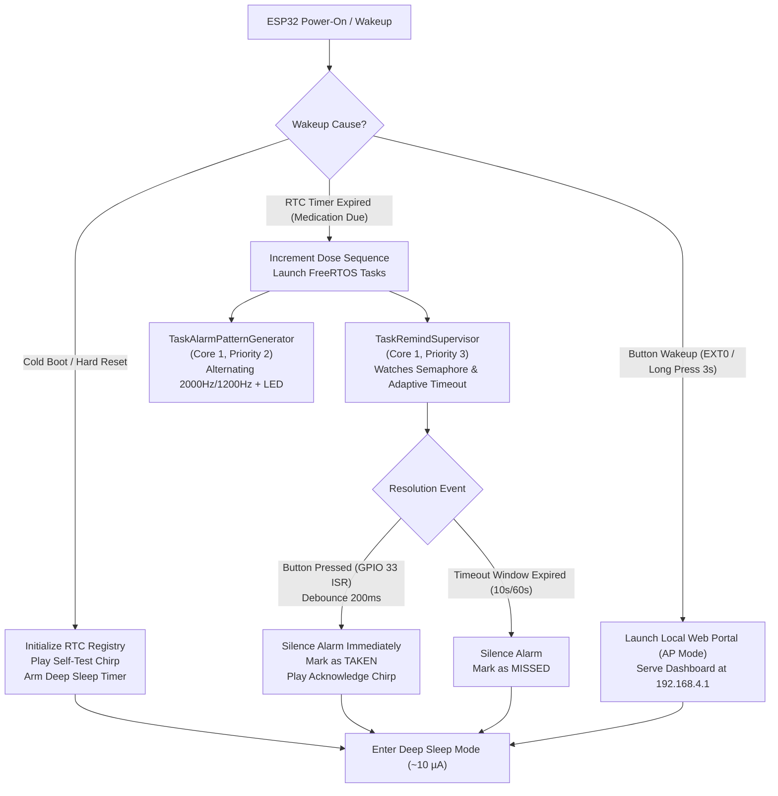

# Smart Timer-Based Medication Reminder

[](https://www.espressif.com/)
[](https://github.com/espressif/arduino-esp32)
[](https://www.freertos.org/)
[](#architecture--freertos-design)
[](#)
[-red)](#power-budget--battery-longevity-analysis)
[-brightgreen)](#power-budget--battery-longevity-analysis)
[](https://github.com/omararafa295-cmd)
[](LICENSE)

An ultra-low-power, standalone **Smart Medication Reminder** built on the **ESP32** microcontroller using **FreeRTOS**, hardware interrupts, 18650 lithium-ion battery power, and deep sleep power management.

Engineered with a **Clean Object-Oriented Architecture (OOP)** in modern C++/Arduino and fully compatible with **ESP32 Arduino Core v3.x+**.

---

## Table of Contents
1. [Core Features](#core-features)
2. [Hardware Pin Mapping & Schematics](#hardware-pin-mapping--schematics)
3. [Architecture & FreeRTOS Design](#architecture--freertos-design)
4. [Power Budget & Battery Longevity Analysis](#power-budget--battery-longevity-analysis)
5. [Adaptive Alarm Timeout & Pharmacokinetic Scheduling](#adaptive-alarm-timeout--pharmacokinetic-scheduling)
6. [Embedded Web Configuration Portal (AP Mode)](#embedded-web-configuration-portal-ap-mode)
7. [Engineering Deep Dive & Design Decisions](#engineering-deep-dive--design-decisions)
8. [Repository Structure](#repository-structure)
9. [Quick Start & Flashing Guide](#quick-start--flashing-guide)
10. [Live Serial Monitor Logs](#live-serial-monitor-logs)
11. [Author](#author)
12. [License](#license)

---

## Core Features

- **Ultra-Low-Power Deep Sleep:** The ESP32 enters deep sleep between medication cycles, keeping the main CPUs, system clocks, and digital peripherals powered off. Only the RTC controller and timer remain active, drawing as low as **`10 µA`**.
- **18650 Li-Ion Battery Operation:** Powered by a rechargeable 3.7V 18650 cell (e.g., EVE ICR18650/26V 2550 mAh) delivering several months of untethered operation away from PCs or wall adapters.
- **RTC Memory Retention (`RTC_DATA_ATTR`):** Medication counters (total doses, confirmed/taken doses, missed doses, and boot cycles) are stored in the **8 KB RTC Slow SRAM**, surviving deep sleep cycles without needing flash rewrites.
- **Hardware LEDC PWM Medical Tone:** Drives a passive piezo buzzer using the ESP32 Hardware LEDC PWM timer to generate an alternating medical alarm pattern (**`2000 Hz`** and **`1200 Hz`**) without blocking execution or loading CPU cores.
- **Synchronous Visual Indicator:** A status LED blinks in strict synchrony with the medical sound frequencies, providing a clear visual alert for noisy environments or hearing-impaired users.
- **Immediate Dismissal via Hardware Interrupt:** External button interrupt on **GPIO 33** (`FALLING` edge) running in `IRAM_ATTR` with tick-based software debouncing (**200 ms**) silences the alarm instantly and logs the dose as **TAKEN**.
- **Adaptive Alarm Window (Battery Guard):**
  - **Demo / Lab Testing:** Auto-silences after **10 seconds** of ringing to ensure comfortable, fast video recording without annoying prolonged noise.
  - **Clinical / Real Usage:** Auto-silences after **60 seconds** to guarantee that the patient has sufficient time to respond before safely powering down to protect battery life.
- **Embedded Web Configuration Portal (Wi-Fi AP):** Hold the button for **3 seconds** to spin up an on-device Wi-Fi Access Point (`MedReminder-Config`) and serve a responsive, standalone web dashboard at `http://192.168.4.1/`. View real-time adherence rates, adjust medication intervals dynamically, test actuators, or reset statistics without modifying code.
- **Dual Mode Configuration:** Configured by default to **15 seconds** for quick laboratory testing and video demonstration, with dynamic web-based or preprocessor adjustment to clinical intervals (e.g., 8 hours).

---

## Hardware Pin Mapping & Schematics

| Component | ESP32 Pin | Electrical Domain | Hardware Configuration | Purpose |
| :--- | :--- | :--- | :--- | :--- |
| **Stop Button** | **GPIO 33** | RTC GPIO (`RTC_GPIO8`) | `INPUT_PULLUP` + RTC Pullup | External hardware interrupt (`FALLING`) to silence alarm & confirm dose |
| **Piezo Buzzer** | **GPIO 25** | Digital Peripherals | Hardware LEDC PWM (10-bit) | Generates alternating medical frequencies (2000 Hz / 1200 Hz) |
| **Status LED** | **GPIO 26** | Digital GPIO | `OUTPUT` (Active-HIGH) | Synchronous visual flashing during alarm |
| **18650 Battery (+)** | **VIN / 5V** | Power Domain | 3.7V Nominal (4.2V Max) | Connects to onboard voltage regulator (stepped down to 3.3V) |
| **18650 Battery (-)** | **GND** | System Ground | Ground Reference | Common ground return |

### Wiring Schematic

```text
       +---------------------------------------------+
       |         EVE ICR18650 Li-Ion Battery         |
       |                   (2550 mAh)                |
       |                                             |
       |  (+) Terminal [Top Cap +] -----------------+------------------> VIN / 5V Pin
       |                                             |
       |  (-) Terminal [Flat Base -] ---------------+------------------> GND Pin
       +---------------------------------------------+

                       +-------------------+
                       |    ESP32 DEVKIT   |
                       |                   |
 (Stop Button) GPIO 33 | [Pin 33]          |
   +---[ Push Button ]---+                 |
   |                   |                   |
  GND                  |                   |
                       |          [Pin 25] | GPIO 25 ----(+) [ Piezo Buzzer ]
                       |                   |                   (-) ---- GND
                       |          [Pin 26] | GPIO 26 ----(+) [ Status LED ]
                       |                   |             (220Ω)---(-) - GND
                       +-------------------+
```

> **Important Wiring Safety Note:**
> - Connect the positive terminal of the 18650 battery **strictly to `VIN` (or `5V`)**. The onboard low-dropout regulator safely regulates the 3.7V–4.2V down to clean 3.3V.
> - **Never connect the battery directly to the `3V3` pin**, as a fully charged battery (4.2V) exceeds the ESP32 silicon maximum rating (3.6V) and will cause irreversible damage.

---

## Architecture & FreeRTOS Design

The system implements strict separation of concerns using Object-Oriented C++ classes coordinated by FreeRTOS tasks:



### Class Responsibilities
- **`DoseRegistry`**: Encapsulates statistics stored in the 8 KB RTC Slow SRAM (`RTC_DATA_ATTR`). Tracks sequence numbers, taken doses, missed doses, dynamic sleep intervals, and overall medication adherence.
- **`SoundAlerter`**: Controls the hardware LEDC PWM timer and status LED. Implements interruptible audio cycles with 10 ms resolution to ensure instant silence on button press.
- **`PowerGuard`**: Inspects wake causes, stabilizes pin release to avoid immediate wake loops, enables RTC pull-up resistors, arms the timer wakeup (`esp_sleep_enable_timer_wakeup`) and EXT0 button wakeup, and commands deep sleep.
- **`WebPortal`**: Spawns an internal HTTP Web Server and Wi-Fi Access Point (`MedReminder-Config`), serving the standalone HTML/CSS/JS mobile dashboard.

---

## Power Budget & Battery Longevity Analysis

### 1. Power Consumption Calculations ($P = V \times I$)
At the standard operating voltage $V = 3.3\text{ V}$:

| Operating State | Current Draw ($I$) | Power Consumption ($P$) | Hardware Subsystem Status |
| :--- | :--- | :--- | :--- |
| **1. Alarm Active (Modem OFF)** | $\approx 30.0\text{ mA}$ | **`99.00 mW`** | Dual Xtensa CPUs @ 240 MHz, LEDC PWM active, Radios OFF |
| **2. Deep Sleep Mode** | $\approx 10.0\text{ }\mu\text{A}$ ($0.01\text{ mA}$) | **`0.033 mW` (`33 µW`)** | CPUs, high-speed clocks & SRAM OFF. Only RTC PMU + Timer active |

$$\text{Power Reduction Ratio} = \left( 1 - \frac{10\text{ }\mu\text{A}}{30000\text{ }\mu\text{A}} \right) \times 100\% = 99.967\%$$

### 2. 18650 Battery Autonomy Estimation
Using an **EVE ICR18650/26V ($2550\text{ mAh}$)** battery under clinical conditions (4 doses per day, each alarm dismissed within an average of 5 seconds):

1. **Sleep Consumption per Day:**
   $$\text{Sleep Time} = 24\text{ hours} - (4 \times 5\text{ s}) \approx 23.994\text{ hours}$$
   $$Q_{\text{sleep}} = 23.994\text{ h} \times 0.010\text{ mA} \approx 0.240\text{ mAh/day}$$

2. **Active Alarm Consumption per Day:**
   $$\text{Active Time} = 4 \times 5\text{ s} = 20\text{ s} = \frac{20}{3600}\text{ hours} \approx 0.00556\text{ h}$$
   $$Q_{\text{active}} = 0.00556\text{ h} \times 30\text{ mA} \approx 0.167\text{ mAh/day}$$

3. **Total Daily Capacity Drain:**
   $$Q_{\text{total}} = Q_{\text{sleep}} + Q_{\text{active}} = 0.240 + 0.167 = 0.407\text{ mAh/day}$$

4. **Estimated Operational Lifespan:**
   $$\text{Lifespan} = \frac{2550\text{ mAh}}{0.407\text{ mAh/day}} \approx 6,265\text{ days} \approx 17\text{ years (Theoretical)}$$

> **Real-World Note:** Accounting for battery self-discharge and the quiescent current of the DevKit's onboard linear regulator (`AMS1117`), the actual standalone runtime is **between 6 and 12+ months** on a single charge without requiring any external power source.

---

## Adaptive Alarm Timeout & Pharmacokinetic Scheduling

### 1. Adaptive Timeout Logic
In typical 15-second demonstration intervals, waiting 60 seconds for an unanswered alarm creates an unbalanced, excessively noisy experience. The firmware implements an adaptive auto-timeout:
- **Fast Lab / Demo Mode ($\le 60\text{ s}$ schedule):** Timeout is set to **`10 seconds`**. The device rings for 10 seconds, registers `MISSED` if unattended, and sleeps for 15 seconds.
- **Clinical Mode ($> 60\text{ s}$ schedule):** Timeout defaults to **`60 seconds`**, providing the patient with adequate time to reach the device.

### 2. Pharmacokinetic Safety (Safe Spacing)
In medical pharmacology, doses must maintain minimum safe therapeutic windows to prevent drug toxicity (overdose). 
The firmware schedules the next deep sleep interval **from the exact timestamp of dose resolution** (either confirmed `TAKEN` or marked `MISSED`), guaranteeing that the required resting interval is strictly honored between consecutive doses.

---

## Embedded Web Configuration Portal (AP Mode)

When the user or clinician holds the push button for **`3 seconds`** (Long Press) during sleep, cold boot, or active alarm:
1. The ESP32 wakes up, plays a rapid 3-beep confirmation chirp, and initializes an on-device Wi-Fi Access Point:
   - **SSID:** `MedReminder-Config`
   - **Default IP:** `http://192.168.4.1/` (Open network, no password required)
2. Connect your mobile phone or laptop to `MedReminder-Config` and open any web browser.
3. A lightweight, responsive **Medical Dashboard** is served directly from Flash memory:
   - **Real-Time Adherence:** Displays scheduled doses, taken doses, missed doses, and compliance rate `%`.
   - **Dynamic Interval Scheduler:** Select presets (15s demo, 1m, 1h, 4h, 6h, 8h, 12h, 24h) or enter custom seconds on-the-fly.
   - **Remote Diagnostics:** Trigger acoustic/visual self-tests or reset telemetry counters.
   - **Fail-Safe Inactivity Guard:** Automatically shuts down Wi-Fi and returns to deep sleep after **3 minutes** if left unattended.

---

## Engineering Deep Dive & Design Decisions

### 1. Power Domain Partitioning & RTC Memory Retention
The ESP32 silicon divides its architecture into two distinct power domains:
- **Digital Core Domain:** Houses dual Xtensa LX6 CPUs, 520 KB SRAM, high-speed APB bus, and digital peripherals. In deep sleep, this entire domain is completely de-energized.
- **RTC Power Domain:** Houses the Power Management Unit (PMU), RTC Controller, 150 kHz internal slow oscillator, and 8 KB RTC Slow SRAM.
By qualifying persistent variables with `RTC_DATA_ATTR`, the compiler maps them into the `.rtc.data` section within RTC SRAM. This avoids wearing out the onboard SPI Flash memory with frequent NVS writes while preserving dosage counters across hundreds of sleep cycles.

### 2. Lock-Free Inter-Task Communication & ISR Safety
Rather than relying on heavy mutexes or critical sections that can introduce priority inversion, the firmware implements lightweight binary semaphore signaling between the hardware ISR and the supervisor task:
- The ISR gives the semaphore via `xSemaphoreGiveFromISR()` and triggers a context switch via `portYIELD_FROM_ISR()` if higher-priority tasks are unblocked.
- The tone generator task evaluates an atomic `volatile bool g_isAlarmActive` flag sliced in 10 ms resolution windows. When cleared, acoustic and visual indicators extinguish in under 10 ms.

### 3. IRAM ISR Allocation (`IRAM_ATTR`)
Hardware ISRs are decorated with the `IRAM_ATTR` macro, forcing the linker to place the executable machine instructions inside internal Instruction RAM (IRAM) rather than external SPI Flash. This guarantees zero cache-miss latency and deterministically fast interrupt handling during hardware edge transitions.

### 4. Contact Bounce Rejection (Tick-Based Debounce)
Mechanical push buttons suffer from physical contact chatter, generating multiple false transitions over a 5 ms to 50 ms window. The debounce engine samples monotonic FreeRTOS system ticks:
$$\Delta t = t_{\text{current}} - t_{\text{last}}$$
Transitions with $\Delta t \le 200\text{ ms}$ are filtered out directly inside the ISR with negligible overhead, guaranteeing that only one clean event triggers per deliberate press.

### 5. Hardware LEDC PWM vs. Software Bit-Banging
Traditional `tone()` implementations or bit-banged loops waste valuable CPU cycles and suffer from frequency jitter caused by higher-priority RTOS interrupts. Leveraging the ESP32 Hardware LEDC peripheral allows the silicon timer to autonomously generate 2000 Hz and 1200 Hz square waves with zero CPU intervention.

---

## Repository Structure

```text
esp32_medication_reminder/
├── .gitignore                     # Git rules ignoring build artifacts and temporary files
├── LICENSE                        # MIT Open-Source License
├── README.md                      # Comprehensive project documentation
├── dashboard_preview.html         # Offline standalone desktop preview of the Web Dashboard
├── AppConfig.h                    # Pin assignments, frequencies, and timing thresholds
├── DoseRegistry.h / .cpp          # RTC SRAM persistent memory manager
├── SoundAlerter.h / .cpp          # Hardware LEDC PWM buzzer & LED driver
├── PowerGuard.h / .cpp            # Deep sleep manager & RTC GPIO controller
├── WebPortal.h / .cpp             # Embedded Web Server, AP Manager & Dashboard UI
└── esp32_medication_reminder.ino  # Main application entry point & FreeRTOS orchestrator
```

---

## Quick Start & Flashing Guide

### Prerequisites
- [Arduino IDE](https://www.arduino.cc/en/software) (version 2.x recommended).
- **ESP32 Arduino Core** (version 3.0.0 or higher):
  - In Arduino IDE, navigate to `File` -> `Preferences`.
  - Add this URL to *Additional boards manager URLs*:
    ```
    https://raw.githubusercontent.com/espressif/arduino-esp32/gh-pages/package_esp32_index.json
    ```
  - Open `Tools` -> `Board` -> `Boards Manager`, search for **esp32**, and click **Install**.

### Build & Upload Steps
1. Clone this repository:
   ```bash
   git clone https://github.com/omararafa295-cmd/esp32_medication_reminder.git
   ```
2. Open the main sketch file in Arduino IDE:
   `esp32_medication_reminder/esp32_medication_reminder.ino`
   *(Arduino IDE will automatically open all accompanying `.h` and `.cpp` files in adjacent tabs).*
3. Select your board from **Tools -> Board -> esp32 -> ESP32 Dev Module**.
4. Select your serial port from **Tools -> Port**.
5. Click **Upload (➔)**.
6. Open **Tools -> Serial Monitor** and set the baud rate to **`115200`**.

---

## Live Serial Monitor Logs

```text
==================================================
  ESP32 TIMER-BASED MEDICATION REMINDER SYSTEM   
  Clean OOP Architecture + FreeRTOS + Deep Sleep 
==================================================
[HAL] Buzzer and Status LED initialized successfully.
[RTC] Cold boot detected: Dose registry initialized.
[BOOT] Wakeup Reason : Cold Boot / Hard Reset / Power-On (Code 0)
[SYSTEM] Cold boot detected. Initializing first medication cycle...
==================================================
       MEDICATION DOSE TRACKER (RTC REPORT)       
==================================================
 Total Wake Cycles : 1
 Current Dose #    : 0
 Confirmed (Taken) : 0
 Ignored (Missed)  : 0
==================================================
[SYSTEM] Entering initial Deep Sleep for 15 seconds...
[POWER] Microcontroller is entering Deep Sleep now. Zzz...

... (15 seconds deep sleep at 10 µA) ...

[BOOT] Wakeup Reason : RTC Timer Expired (Medication Due) (Code 4)
[ALARM] Scheduled medication interval elapsed. Triggering alert!
[SUPERVISOR] Alarm ringing (Timeout set to 10 s). Monitoring button & timeout...

>>> [USER ACTION] Stop Button Pressed (GPIO 33)!
[STATUS] Result: DOSE CONFIRMED (TAKEN).
==================================================
       MEDICATION DOSE TRACKER (RTC REPORT)       
==================================================
 Total Wake Cycles : 2
 Current Dose #    : 1
 Confirmed (Taken) : 1
 Ignored (Missed)  : 0
 Adherence Rate    : 100.0 %
==================================================
[POWER] Microcontroller is entering Deep Sleep now. Zzz...
```

---

## Author

Developed by **Omar Arafa**
- GitHub: [@omararafa295-cmd](https://github.com/omararafa295-cmd)

---

## License

This project is licensed under the MIT License - see the [LICENSE](LICENSE) file for details.
